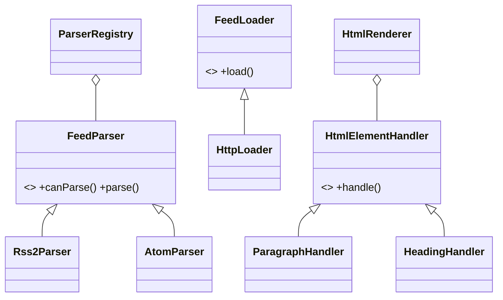

# DESIGN — RSS/Atom читалка

## 1. Общая идея
Программа — консольная читалка лент RSS 2.0 и Atom 1.0. Скачивает ленты по HTTP (с кэшированием ETag), парсит их, отрисовывает HTML-текст статей в терминал, сохраняет флаги прочитанного.

## 2. Архитектура (3 слоя)
Зависимости строго вниз: `tui` -> `app` -> `core`.

- **core** — ядро. Модели (`Feed`, `Article`), парсеры лент, загрузчик HTTP, HTML-рендерер, хранилище. **Не линкуется с FTXUI** (проверяется CMake).
- **app** (будет на 4-й неделе) — состояние сеанса, команды, реестр клавиш.
- **tui** (будет на 4-й неделе) — интерфейс на FTXUI (списки, экраны).

## 3. Ключевые паттерны (GoF)
1. **Factory Method / Strategy** (Порождающий/Поведенческий) — `ParserRegistry`. Выбирает подходящий парсер (`Rss2Parser` или `AtomParser`) на основе `canParse(xml)`.
2. **Strategy** (Поведенческий) — `HtmlElementHandler`. Разные теги (`
`, `<h1>`, `<a>`) имеют разные правила отрисовки. Легко добавить таблицу (`<table>`).
3. **Adapter** (Структурный) — `HttpLoader` адаптирует библиотеку `libcurl` к интерфейсу `FeedLoader`.
4. **Observer** (Поведенческий, будет на 4-й неделе) — уведомление UI о завершении фоновой загрузки в отдельном потоке.

## 4. Точки расширения (из ТЗ)
1. **Новый формат ленты**: реализовать `FeedParser`, добавить в `ParserRegistry`.
2. **Новый HTML-тег**: реализовать `HtmlElementHandler`, добавить в `HtmlRenderer`.
3. **Новый источник лент**: реализовать `FeedLoader` (например, чтение локальных файлов).
4. **Новый способ хранения**: реализовать `StateStore` (будет на 4-й неделе).

## 5. Диаграмма классов (Mermaid)
