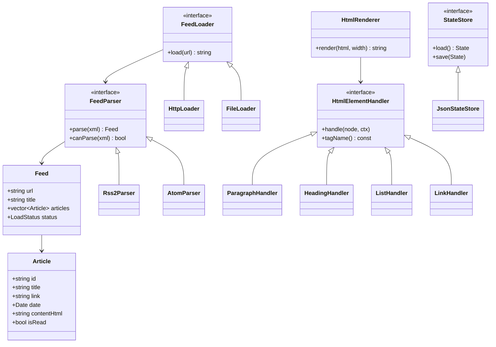

# DESIGN — RSS/Atom читалка

## 1. Общая идея

Программа — консольная читалка новостных лент RSS 2.0 и Atom 1.0.
Читает ленты по HTTP, показывает список подписок, список статей и текст
статьи, отрисованный из HTML в терминал с переносом по ширине и
сносками для ссылок. Флаги «прочитано» и подписки сохраняются между
запусками.

Ключевая сложность — собственная отрисовка HTML в текст, разбор двух
форматов лент в одну модель и семантика HTTP-кэша через ETag и
Last-Modified.

## 2. Архитектура

### 2.1. Три слоя

Зависимости строго вниз: `tui → app → core`.

- **core** — модель предметной области, разбор RSS/Atom, HTTP-загрузка,
  отрисовка HTML, хранение состояния. Не знает о терминале и FTXUI.
  Собирается в отдельную цель CMake, **не линкуется с TUI-библиотекой**
  (требование ТЗ).
- **app** — состояние сеанса, команды пользователя, реестр команд,
  привязка клавиш из конфига. Зависит только от `core`.
- **tui** — экраны на FTXUI: список лент, список статей, просмотр статьи,
  строка состояния, экран справки. Зависит от `app` и `core`.

### 2.2. Диаграмма классов



### 2.3. Пояснения к классам

**Модель:**

- `Feed` — одна лента: `url`, `title`, `articles` (вектор), `status`.
- `Article` — одна статья: `id`, `title`, `link`, `date`, `contentHtml`, `isRead`.

**Разбор:**

- `FeedParser` — интерфейс с `parse` и `canParse`.
- `Rss2Parser` и `AtomParser` — реализации для двух форматов.

**Загрузка:**

- `FeedLoader` — интерфейс с `load`.
- `HttpLoader` (libcurl, ETag/Last-Modified) и `FileLoader` (локальный файл).

**Отрисовка HTML:**

- `HtmlRenderer` — обход дерева, перенос, сноски.
- `HtmlElementHandler` — интерфейс обработки одного тега.
- `ParagraphHandler`, `HeadingHandler`, `ListHandler`, `LinkHandler`.

**Хранилище:**

- `StateStore` — интерфейс `load`/`save`.
- `JsonStateStore` — JSON в `~/.config/rss-reader/state.json`.

## 3. Модель предметной области

```cpp
struct Feed {
    std::string         url;
    std::string         title;
    std::vector<Article> articles;
    LoadStatus          status;   // Unknown/Loading/Ok/Error
};

struct Article {
    std::string id;           // GUID или хеш от link+date
    std::string title;
    std::string link;
    std::chrono::system_clock::time_point date;
    std::string contentHtml;  // исходный HTML
    bool        isRead = false;
};
```

Владеет `FeedRepository` через `std::vector<Feed>`.
Сырых указателей и ручного `delete` нет — правило нуля.
## 4. Разбор лент (RSS/Atom)

- Вход: строка XML.
- Выход: `Feed` с заполненными `Article`.
- Парсеры: `Rss2Parser` (корневой `<rss>`), `AtomParser` (корневой `<feed>`).
- Выбор по `canParse(xml)`: смотрим корневой тег.
- XML разбираем через **pugixml** или **lexbor** (разрешено ТЗ).
- **Нельзя** использовать готовые библиотеки разбора лент (запрещено ТЗ).

## 5. Загрузка по сети и кэширование

- `HttpLoader` через libcurl.
- Первый запрос: тело + `ETag` + `Last-Modified` → сохраняем в `State`.
- Повторный: шлём `If-None-Match` / `If-Modified-Since`.
- Ответ `304 Not Modified` → тело пустое, берём из кэша.
- **ТЗ:** «Повторная загрузка использует ETag и Last-Modified».

## 6. Отрисовка HTML в текст

- Разбор HTML в дерево (pugixml/lexbor).
- `HtmlRenderer::walk` обходит дерево, для каждого тега — свой `HtmlElementHandler`.
- Обработчики: `<p>`, `<h1..h6>`, `<ul>/<ol>/<li>`, `<blockquote>`, `<a>`.
- **Перенос по словам** под ширину окна (`RenderContext::wrapLine`).
- **Сноски:** `<a>` → текст `[N]`, список адресов в конце.
- **Неизвестные теги** — пропускаются, их текст показывается (требование ТЗ).
- **Resize окна** — `HtmlRenderer` вызывается заново с новой шириной.

## 7. Хранение состояния

- `State` — подписки, флаги прочитанного, кэш ETag/Last-Modified.
- `JsonStateStore` — JSON через `nlohmann/json`.
- **Атомарная запись:** пишем во временный файл, потом `rename`.
- Файл: `~/.config/rss-reader/state.json`.
## 8. Точки расширения

### 8.1. Новый формат ленты (JSON Feed, RSS 1.0)

**Интерфейс:** `FeedParser` (`parse`, `canParse`).

**Как добавить:**
1. Создать класс `JsonFeedParser : public FeedParser`.
2. Реализовать `parse` и `canParse`.
3. Зарегистрировать в `ParserRegistry` в точке сборки:
   ```cpp
   registry.add(std::make_unique<JsonFeedParser>());
   ```

**Паттерн:** Factory Method.

**Существующие классы не меняются.**

### 8.2. Новый HTML-тег (таблица, блок кода)

**Интерфейс:** `HtmlElementHandler` (`handle`, `tagName`).

**Как добавить:**
1. Создать `TableHandler : public HtmlElementHandler`.
2. Реализовать `handle`.
3. Зарегистрировать в `HandlerRegistry`:
   ```cpp
   registry.add("table", std::make_unique<TableHandler>());
   ```

**Паттерн:** Strategy.

**Существующие классы не меняются.**

### 8.3. Новый источник лент (локальный файл, другой транспорт)

**Интерфейс:** `FeedLoader` (`load`).

**Как добавить:**
1. Создать `ZipLoader : public FeedLoader`.
2. Реализовать `load`.
3. Зарегистрировать в `LoaderFactory`.

**Паттерн:** Factory Method + Adapter.

**Существующие классы не меняются.**

### 8.4. Новый способ хранения состояния (SQLite, YAML)

**Интерфейс:** `StateStore` (`load`, `save`).

**Как добавить:**
1. Создать `SqliteStateStore : public StateStore`.
2. Реализовать `load` и `save`.
3. Подменить в `main` при конструировании `FeedRepository`.

**Паттерн:** Strategy + Adapter.

**Существующие классы не меняются.**

## 9. Паттерны проектирования

### 9.1. Factory Method (порождающий)

**Где:** `ParserRegistry`, `LoaderFactory`, `HandlerRegistry`.

**Проблема:** на этапе выполнения нужно создать объект подходящего
класса (парсер под XML, загрузчик под URL, обработчик под тег),
не зная заранее, какой именно.

**Почему не switch:** при добавлении нового формата пришлось бы
править switch, нарушая Open/Closed.

**Альтернатива:** `enum` + `switch`. Отказались — плохо расширяется.

### 9.2. Adapter (структурный)

**Где:** `FileLoader`, `JsonStateStore`.

**Проблема:** у нас есть разные источники (HTTP, файловая система) и
разные способы хранения (JSON-файл, будущий SQLite). Все они приводятся
к единому интерфейсу.

**Альтернатива:** наследование от общего класса. Отказались — 
адаптеры могут быть не связаны иерархией.

### 9.3. Strategy (поведенческий)

**Где:** `FeedParser`, `HtmlElementHandler`, `FeedLoader`.

**Проблема:** для одного интерфейса есть несколько разных алгоритмов
(парсинг RSS vs Atom, отрисовка `<p>` vs `<h1>`).

**Альтернатива:** один класс с `if/switch`. Отказались — 
нарушает Single Responsibility и Open/Closed.

### 9.4. Command (поведенческий)

**Где:** `Command` + `CommandRegistry` (слой app).

**Проблема:** действия пользователя нужно привязать к клавишам из
конфига. Клавиша → команда → выполнение.

**Альтернатива:** огромный `switch` в обработчике событий.
Отказались — нельзя расширить из конфига.

### 9.5. Observer (поведенческий)

**Где:** уведомление UI о завершении фоновой загрузки.

**Проблема:** фоновый поток завершил загрузку — UI должен
перерисоваться. Жёсткая связь с UI невозможна (core не знает о TUI).

**Альтернатива:** polling в UI (проверять статус каждые N мс).
Отказались — трата CPU и задержка.

## 10. Фоновые задачи

- Загрузка каждой ленты в `std::thread`.
- Результаты под `std::mutex`.
- `Observer` уведомляет UI: `notifyObservers(url)`.
- UI: `screen.PostEvent(Event::Custom)` → перерисовка.
- **ТЗ:** «Долгие операции (сеть, разбор больших файлов) не блокируют
  интерфейс».

## 11. Обработка ошибок

- Иерархия: `DomainError` → `NetworkError`, `ParseError`, `StorageError`.
- Ловим в фоновом потоке, ставим `feed.status = Error`, `feed.error = текст`.
- UI показывает ошибку в строке состояния.
- Программа продолжает работу — требование ТЗ.

